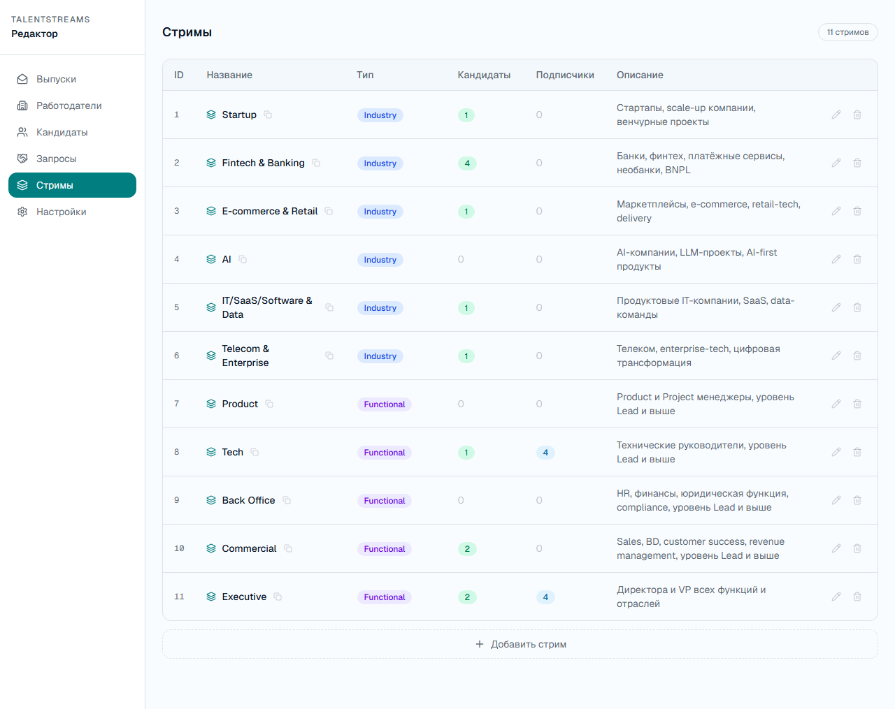
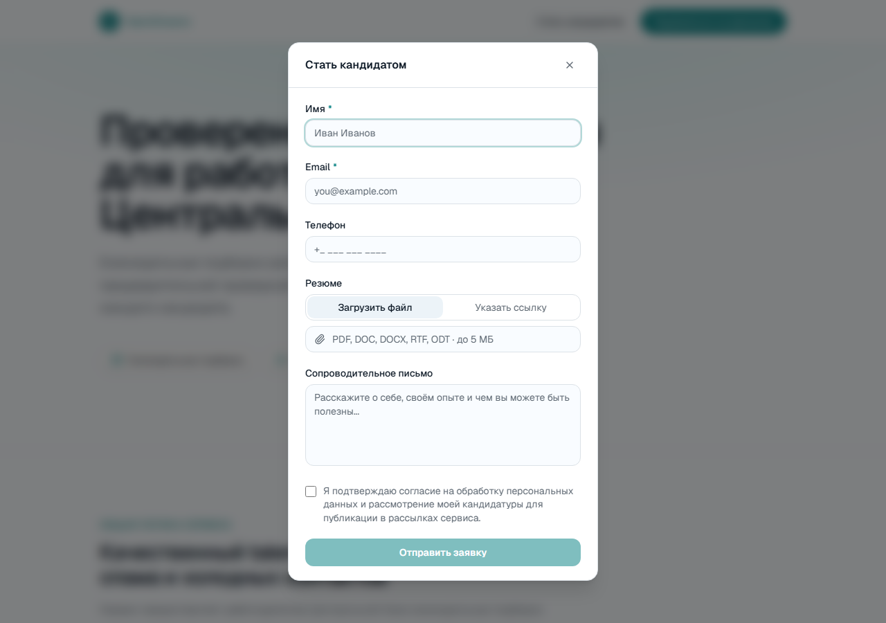
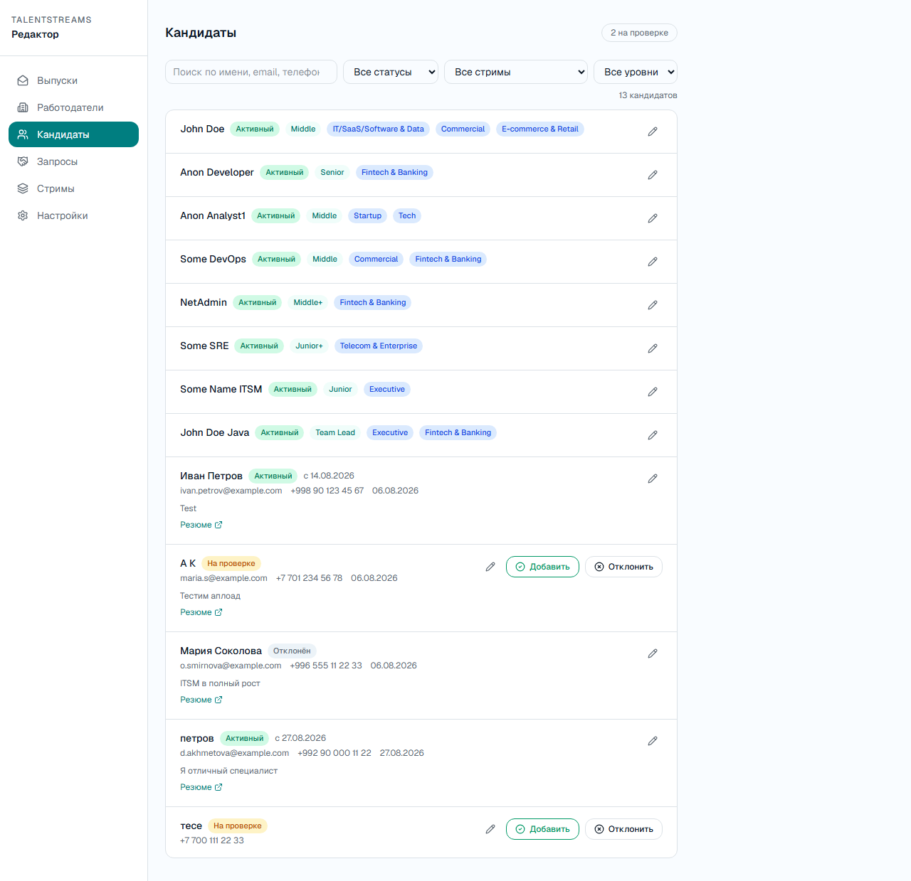
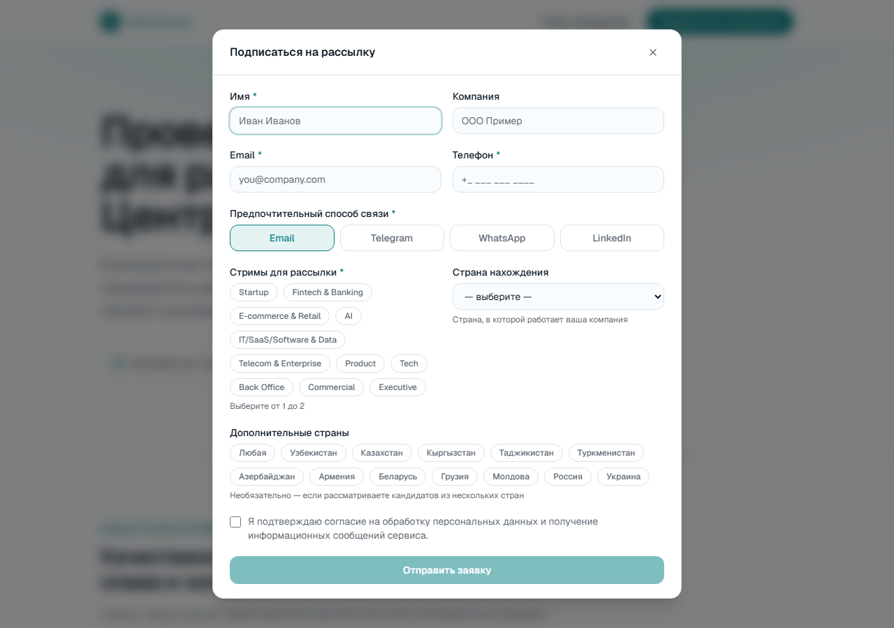
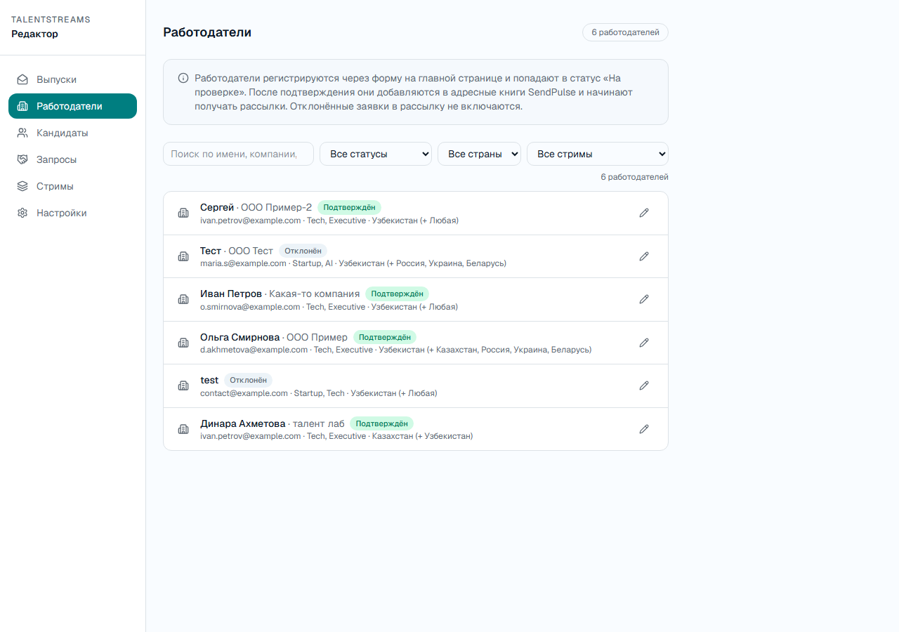
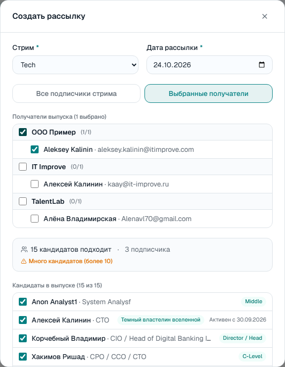
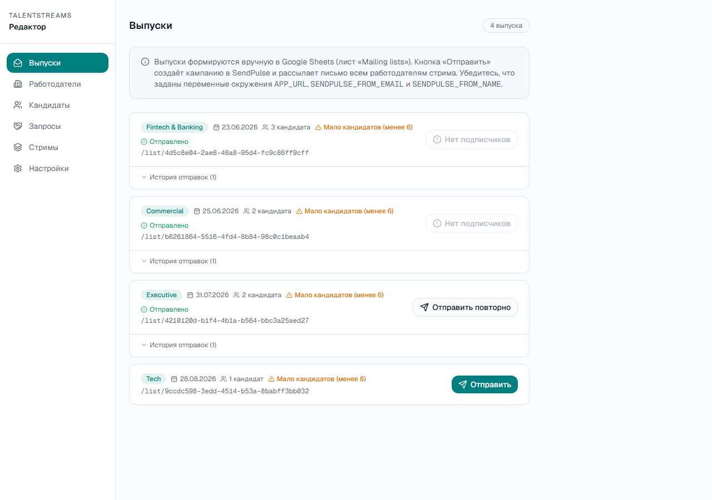

= Плейбук TalentStreams — для менеджера
:toc: left
:toc-title: Содержание
:toclevels: 2
:sectnums:
:icons: font
:lang: ru

Три вещи, которые нужно уметь: занести кандидата, занести работодателя и отправить рассылку по стриму. Ниже — куда кликать, что писать и на чём чаще всего спотыкаются. Без технического жаргона.

== Быстрые ссылки

Сохраните эту страницу и ссылки ниже — они понадобятся почти на каждом шаге.

[cols="1,3", options="header"]
|===
| Что | Ссылка

| Публичный сайт (форма регистрации, подборки)
| https://www.talentlabstreams.com

| Админка (редактор) — одобрение, фильтры, рассылка
| https://www.talentlabstreams.com/editor?secret=ВАШ_СЕКРЕТ
|===

IMPORTANT: ❗ `ВАШ_СЕКРЕТ` в ссылке админки — это пароль доступа, свой у компании. Без него редактор не откроется (будет просто «страница не найдена»). Уточните его у *Алексея Калинина* один раз и сохраните ссылку целиком в закладки — дальше при переходах между разделами редактора он сам подставляется во все ссылки.

== Как всё устроено — коротко

Три факта, которые объясняют всё остальное в этой инструкции:

* *Кандидаты и работодатели — только на сайте.* Все поля заносятся и правятся в разделе «Редактор»; отдельной таблицы для ручного ввода больше нет ни у тех, ни у других.
* *Стрим — это направление подборки*, и их ровно 11, список фиксированный (см. ниже). Кандидат и работодатель привязываются к стриму по точному совпадению названия — «Финтех» и «Fintech & Banking» это два разных, не связанных друг с другом слова для системы.
* *Рассылка = «выпуск».* Это подборка кандидатов одного стрима, которую получают по почте все подтверждённые работодатели, подписанные на этот стрим.

=== Список стримов (актуален на сегодня)

Отраслевые (Industry): Startup, Fintech & Banking, E-commerce & Retail, AI, IT/SaaS/Software & Data, Telecom & Enterprise.

По функции (Functional): Product, Tech, Back Office, Commercial, Executive.

Полный список с описаниями и живыми счётчиками — сколько подходящих кандидатов и сколько подтверждённых подписчиков-работодателей у каждого стрима — в разделе «Стримы» редактора:

Стрим можно переименовать, изменить тип/описание или удалить прямо в этой таблице (карандаш/корзина в строке). Если по стриму уже отправляли хотя бы одну рассылку — переименовать и удалить его нельзя (кнопка «Удалить» пропадает, поле названия недоступно при редактировании), только *архивировать* (иконка рядом с корзиной). Архивный стрим переезжает в схлопнутую секцию «Архивные стримы» внизу страницы и перестаёт предлагаться где бы то ни было при выборе стрима заново — в формах регистрации, в форме создания рассылки, в фильтрах кандидатов/работодателей. Из архивной секции его можно в любой момент вернуть обратно кнопкой «Восстановить». Рядом с названием стрима — число рядом со стрелкой: клик разворачивает список всех его рассылок (дата, количество кандидатов, отправлена ли).

== Кандидаты — где заполнять и что важно

Есть два способа завести кандидата в системе — оба на сайте, разница только в том, кто заполняет форму.

=== Способ А. Кандидат сам подаёт заявку на сайте

На главной странице есть кнопка «Стать кандидатом» — открывается короткая форма (имя, email, телефон, резюме, сопроводительное письмо).

Заявка попадает в редактор со статусом «На проверке». Дальше её нужно донаполнить и одобрить — см. <<Одобрение и донаполнение — раздел «Кандидаты» на сайте>>.

=== Способ Б. Вы сами заносите кандидата в редакторе

Кнопка «+ Добавить кандидата» в панели фильтров раздела «Кандидаты» — открывается та же форма, что и при редактировании (см. ниже), но пустая. Удобно, когда кандидат присылает данные не через сайт (письмом, в мессенджере) — заносите сразу со всеми деталями одним шагом, а не отдельно «заявка» и отдельно «донаполнение».

Поля: Имя, Роль, Email, Телефон, Уровень, Активен с (по умолчанию — сегодня), Страна (текущая/желаемая), Стримы, Summary, Резюме (файл или ссылка), Сопроводительное письмо. Исключённые компании/стримы здесь не заполняются — их можно добавить позже через карандаш, см. предупреждение ниже.

Кандидат, занесённый этим способом, тоже попадает со статусом «На проверке» — заносить и проверять может быть разный человек (секретарь и рекрутёр, например).

[WARNING]
====
*⚠️ Про `Исключённые компании` / `Исключённые стримы`*

Правятся в форме редактирования кандидата (карандаш → поля «Исключённые компании»/«Исключённые стримы» внизу формы, выделены красной рамкой со значком-стопом — легко заметить среди остальных полей) — вводятся по одному значению, Enter добавляет как отдельный тег, крестик на теге удаляет. По мере набора (от 3 символов) сайт подсказывает варианты — для компаний из уже существующих в разделе «Компании», для стримов — из актуального списка (§2); подсказку можно выбрать кликом или просто дописать своё значение и нажать Enter. Система сравнивает эти поля с данными работодателя *посимвольно*, без права на опечатку:

* *Исключённые компании* сверяется с полем «Компания» работодателя. С недавних пор при регистрации компания выбирается из подсказок (или заводится новая, если такой ещё нет) — одна и та же компания у всех её сотрудников-работодателей теперь пишется одинаково, опечатки вроде «ООО Пример» vs «Пример» для *новых* заявок больше не расходятся. Но сверка по-прежнему посимвольная: выберите подсказку или впишите название *точно* так, как оно показано в разделе <<Компании — кто у кого работает>> на сайте — иначе исключение всё равно не сработает, кандидат попадёт в подборку, и ошибки или предупреждения нигде не будет.
* *Исключённые стримы* сравнивается не со свободным описанием отрасли, а со *стримами* работодателя — подсказка показывает точные названия из списка (§2), так что опечатки здесь теперь маловероятны, но при ручном вводе всё равно вписывайте точно, а не произвольное слово вроде «финтех» или «ритейл».

Если сомневаетесь, что кандидат действительно исключён — не полагайтесь на эти поля вслепую, проверьте отправленную ему подборку напрямую.
====

=== Одобрение и донаполнение — раздел «Кандидаты» на сайте

Все кандидаты — и с сайта, и занесённые вручную — видны в редакторе. Сверху панель фильтров (поиск, статус, стрим, уровень), справа от каждой строки — карандаш для редактирования и кнопки «Добавить» / «Отклонить» для тех, кто «На проверке».

Карандаш открывает форму с именем, ролью, email, телефоном, резюме, сопроводительным письмом, summary, уровнем, стримами, страной и датой активности — включая *Роль* и *Summary*, то есть всё, что реально видит работодатель на карточке. Пара старых полей (`Industry`/`Function`) системой сейчас нигде не используется и в форме не показывается — заполнять их не нужно.

== Работодатели — где заполнять и что важно

В отличие от кандидатов, здесь только один способ — форма на сайте. Отдельной таблицы для ручного ввода работодателей нет.

Кнопка «Подписаться на рассылку» в шапке сайта — форма собирает имя, компанию (обязательное поле — по мере ввода сайт подсказывает уже существующие компании, можно выбрать из списка или вписать новую), контакты, способ связи, до двух стримов и страну/страны.

«Страна нахождения» теперь обязательна — если нужной страны нет в списке, выбирайте «Другая». «Дополнительные страны» можно оставить пустым: сайт сам сохранит это как «Любая» (т.е. гео-фильтр подборки для этого работодателя не будет ограничен странами вообще) — щёлкать «Любая» вручную не обязательно, но можно, результат тот же.

Заявка сразу видна в редакторе со статусом «На проверке». Служебный идентификатор (по нему строится персональная ссылка на подборку и связь с рассылкой) форма генерирует сама при отправке, каждый раз без исключений — прежней подстраховки «на случай, если скрипт не сработал при массовой вставке» здесь больше не нужно.

=== Подтверждение — раздел «Работодатели» на сайте

Здесь та же панель фильтров (поиск, статус, страна, стрим), карандаш для редактирования любых полей кроме статуса, и кнопки «Подтвердить»/«Отклонить» для заявок «На проверке».

[NOTE]
====
*ℹ️ Что реально происходит по клику «Подтвердить»*

Работодатель добавляется в базу рассылки (SendPulse) и сразу же автоматически получает приветственное письмо. Нажимайте только когда контакты и стримы точно верны — отменить отправку письма потом нельзя, только откорректировать данные на будущее.
====

=== Компании — кто у кого работает

Отдельный раздел «Компании» в редакторе — список всех компаний, из которых зарегистрированы работодатели. Строка раскрывается кликом и показывает всех людей из этой компании с их статусом («На проверке»/«Подтверждён»/«Отклонён»).

Полезно для двух вещей: проверить, что у компании уже есть подтверждённый контакт, прежде чем подтверждать ещё одного человека оттуда же, и найти точное написание названия компании для поля «Исключённые компании» в форме редактирования кандидата (см. предупреждение выше). Компании без указанного названия (были заведены до того, как поле стало обязательным) сгруппированы под «Не определено».

== Как сделать рассылку

Рассылка = «выпуск»: подборка кандидатов одного стрима на конкретную дату. Работодатели, подтверждённые и подписанные на этот стрим, получат письмо со ссылкой.

IMPORTANT: ❗ Выпуски хранятся в базе данных — таблицы «Mailing lists» в Google Sheets больше не существует. Единственный способ собрать выпуск — кнопка «Создать рассылку» ниже.

=== Кнопка «Создать рассылку»

В разделе «Выпуски» — кнопка «Создать рассылку». Открывается форма:

. Выберите *стрим* и *дату*.
. Сайт сам покажет, сколько кандидатов подходит и сколько подтверждённых подписчиков-работодателей у этого стрима — жёлтое/красное предупреждение прямо в форме (меньше 6 или больше 10 кандидатов, 0 подписчиков), ещё до создания выпуска.
. Ниже — список подходящих кандидатов с галочками, все отмечены по умолчанию. Рядом с именем — дата «Активен с». Уберите галочку у тех, кого не хотите включать в этот выпуск.
. Кандидатов не хватает? Ниже основного списка — схлопнутая ссылка «Кандидаты на паузе, дата не наступила». Разверните её и отметьте галочкой того, кто нужен, даже если по правилам ему ещё рано — система это позволяет, решение остаётся за вами.
. Нажмите «Создать рассылку» — выпуск появится в списке ниже, дальше как обычно: «Отправить».

IMPORTANT: ❗ В основной список автоматически попадают только кандидаты нужного стрима со статусом «Активный», у которых дата «Активен с» уже наступила (или вообще не проставлена) — остальные подходящие по стриму кандидаты уходят в список «на паузе» (см. выше), откуда их можно включить вручную. Если нужного кандидата нет вообще ни в одном из двух списков (не тот стрим, ещё не подтверждён, или статус не «Активный»/«Не публиковать») — сначала поправьте это в разделе «Кандидаты» (§3), отдельного способа добавить его в обход списков сейчас нет.

TIP: 💡 Дата «Активен с» после отправки выпуска обновляется сама: после 1-й реальной отправки кандидата — пауза 2 недели, после 2-й — 3 месяца, после 3-й кандидат автоматически получает статус «Не публиковать» и пропадает из всех выпусков насовсем (карточку кандидата, если он всё же понадобится, можно вернуть в «Активный» кнопкой «Подтвердить» на странице «Кандидаты», §3). Создание выпуска без реальной отправки на этот счётчик не влияет — только «Отправить».

=== Отправка

. *Откройте раздел «Выпуски» на сайте.* +
Новая карточка появится по вашему `List ID`. Если кандидатов меньше 6 или больше 10 — увидите жёлтое предупреждение прямо на карточке, это не блокирует отправку. +
+

. *Нажмите «Отправить».* +
Если у стрима нет ни одного подтверждённого подписчика, кнопка покажет «Нет подписчиков» и не даст отправить — тогда сначала подтвердите работодателей. Уже отправленный выпуск можно отправить повторно кнопкой «Отправить повторно».
+
Дата на карточке выпуска — это план, а не обязательство: если отправляете не в тот день, что планировали при создании выпуска, дата сама обновится на сегодняшнюю в момент первой отправки. Повторная отправка того же выпуска дату уже не меняет.

Работодатель получает письмо со ссылкой на персональную подборку (без точного числа кандидатов текстом — специально, чтобы не давать обещаний, которые может не выполнить гео-фильтр). Перейдя по ссылке, он видит анонимные карточки: должность, уровень, страна, теги стримов, краткое summary — без имён и контактов.

TIP: Ошиблись в выпуске, который ещё не отправляли? Рядом с «Отправить» — корзина: подтвердите удаление, и выпуск пропадёт. Как только выпуск отправлен хотя бы раз, корзина исчезает — удалить отправленный выпуск через сайт нельзя (кампания уже ушла работодателям, удаление это не отменит).

== Шпаргалка

=== Перед тем как добавить кандидата вручную

* `Стрим` совпадает с названием из списка дословно
* `Summary` написан — это единственное, что увидит работодатель
* Статус после добавления — «На проверке»: кандидат никому не виден, пока не одобрите (§3)

=== Перед тем как подтвердить работодателя

* Email и телефон верны — подтверждение необратимо шлёт письмо
* `Streams` совпадают с названиями из списка

=== Перед отправкой рассылки

* У стрима есть хотя бы несколько активных кандидатов
* У стрима есть хотя бы один подтверждённый подписчик
* Оба счётчика уже видны в форме «Создать рассылку» до создания выпуска — отдельно проверять не нужно

== Если что-то не так

Не открывается редактор, ссылка на подборку не работает, письмо не пришло — не гадайте, что сломалось: сразу к *Алексею Калинину*. Почти всегда причина одна из трёх в шпаргалке выше.
