= Плейбук TalentStreams — для менеджера
:toc: left
:toc-title: Содержание
:toclevels: 2
:sectnums:
:icons: font
:lang: ru

Четыре вещи, которые нужно уметь: занести кандидата, занести работодателя, подготовить подборку и собрать из неё рассылку по стриму. Ниже — куда кликать, что писать и на чём чаще всего спотыкаются. Без технического жаргона.

== Быстрые ссылки

Сохраните эту страницу и ссылки ниже — они понадобятся почти на каждом шаге.

[cols="1,3", options="header"]
|===
| Что | Ссылка

| Публичный сайт (форма регистрации, подборки)
| https://www.talentlabstreams.com

| Админка (редактор) — одобрение, фильтры, рассылка
| https://www.talentlabstreams.com/editor?secret=ВАШ_СЕКРЕТ

| Google-таблица для массового ввода кандидатов (Способ В)
| https://docs.google.com/spreadsheets/d/1Jez_Ql5jWRmOt02sU4ige9wFI6yAjhVDyDUc0-lCJPM/edit
|===

IMPORTANT: ❗ `ВАШ_СЕКРЕТ` в ссылке админки — это пароль доступа, свой у компании. Без него редактор не откроется (будет просто «страница не найдена»). Уточните его у *Алексея Калинина* один раз и сохраните ссылку целиком в закладки — дальше при переходах между разделами редактора он сам подставляется во все ссылки.

== Как всё устроено — коротко

Три факта, которые объясняют всё остальное в этой инструкции:

* *Все поля — и у кандидатов, и у работодателей — правятся в разделе «Редактор».* Для массового ввода кандидатов есть ещё Google-таблица (Способ В ниже) — но это только *добавление* новых, подборку и рассылку она не затрагивает, и отдельной таблицы для работодателей нет вовсе.
* *Стрим — это направление подборки*, и их ровно 11, список фиксированный (см. ниже). Кандидат и работодатель привязываются к стриму по точному совпадению названия — «Финтех» и «Fintech & Banking» это два разных, не связанных друг с другом слова для системы.
* *Подборка и выпуск — две разные вещи.* Подборка — набор кандидатов, подготовленный заранее для стрима (раздел «Подборки»): общая (видна всем подписчикам стрима) или ограниченная (видна только выбранным работодателям/компаниям). Выпуск («рассылка») — письмо, которое реально уходит в SendPulse; при его создании вы просто выбираете, какие уже готовые подборки в него войдут. Подробнее — в <<selections-vs-releases,«Подборки и выпуски — как это устроено»>>.

=== Список стримов (актуален на сегодня)

Отраслевые (Industry): Startup, Fintech & Banking, E-commerce & Retail, AI, IT/SaaS/Software & Data, Telecom & Enterprise.

По функции (Functional): Product, Tech, Back Office, Commercial, Executive.

Полный список с описаниями и живыми счётчиками — сколько подходящих кандидатов и сколько подтверждённых подписчиков-работодателей у каждого стрима — в разделе «Стримы» редактора:

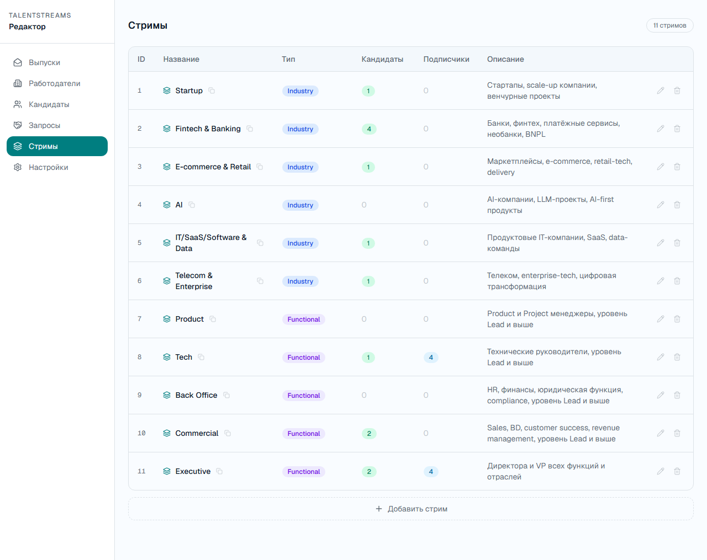

Стрим можно переименовать, изменить тип/описание или удалить прямо в этой таблице (карандаш/корзина в строке). Если по стриму уже отправляли хотя бы одну рассылку — переименовать и удалить его нельзя (кнопка «Удалить» пропадает, поле названия недоступно при редактировании), только *архивировать* (иконка рядом с корзиной). Архивный стрим переезжает в схлопнутую секцию «Архивные стримы» внизу страницы и перестаёт предлагаться где бы то ни было при выборе стрима заново — в формах регистрации, в форме создания рассылки, в фильтрах кандидатов/работодателей. Из архивной секции его можно в любой момент вернуть обратно кнопкой «Восстановить». Рядом с названием стрима — число рядом со стрелкой: клик разворачивает список всех его рассылок (дата, количество кандидатов, отправлена ли).

== Кандидаты — где заполнять и что важно

Есть три способа завести кандидата в системе.

=== Способ А. Кандидат сам подаёт заявку на сайте

На главной странице есть кнопка «Стать кандидатом» — открывается короткая форма (имя, email, телефон, резюме, сопроводительное письмо).

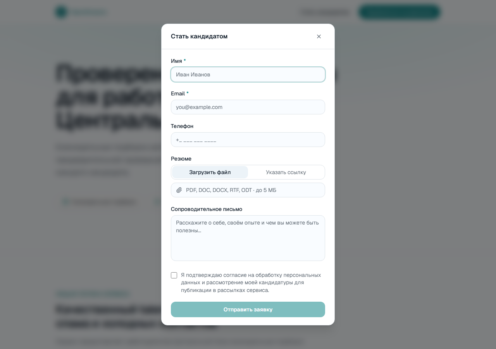

Заявка попадает в редактор со статусом «На проверке». Дальше её нужно донаполнить и одобрить — см. <<Одобрение и донаполнение — раздел «Кандидаты» на сайте>>.

=== Способ Б. Вы сами заносите кандидата в редакторе

Кнопка «+ Добавить кандидата» в панели фильтров раздела «Кандидаты» — открывается та же форма, что и при редактировании (см. ниже), но пустая. Удобно, когда кандидат присылает данные не через сайт (письмом, в мессенджере) — заносите сразу со всеми деталями одним шагом, а не отдельно «заявка» и отдельно «донаполнение».

Поля: Имя, Роль, Email, Телефон, Уровень, Активен с (по умолчанию — сегодня), Страна (текущая/желаемая), Стримы, Summary, Резюме (файл или ссылка), Сопроводительное письмо. Исключённые компании/стримы здесь не заполняются — их можно добавить позже через карандаш, см. предупреждение ниже.

Кандидат, занесённый этим способом, тоже попадает со статусом «На проверке» — заносить и проверять может быть разный человек (секретарь и рекрутёр, например).

=== Способ В. Заполнить Google-таблицу и импортировать

Для массового ввода (много кандидатов сразу, например после сбора резюме с партнёрами) — заполните строки в Google-таблице (ссылка — в <<Быстрые ссылки>>), затем в разделе «Настройки» редактора нажмите «Проверить таблицу».

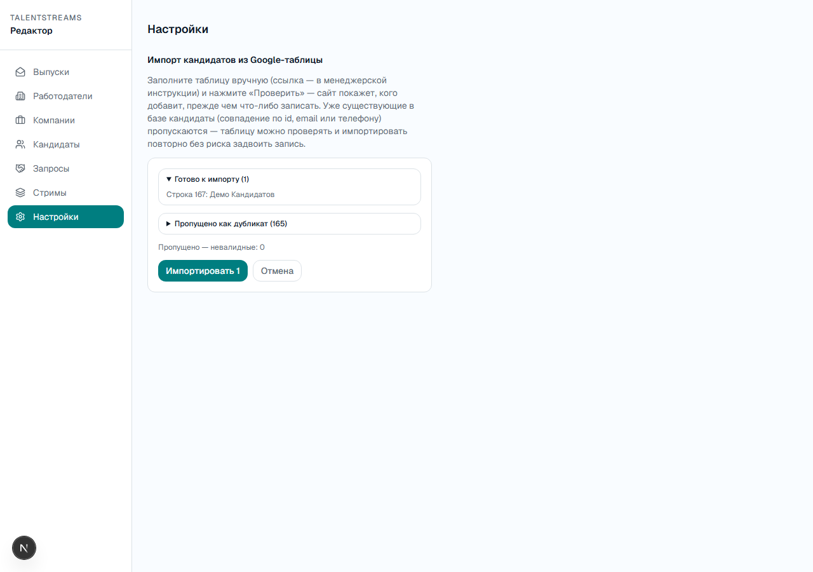

Сайт покажет, что сделал бы импорт, *ничего не записывая*: сколько кандидатов готово к импорту, сколько пропущено как уже существующие (дубликат по id/email/телефону), сколько — как невалидные (обычно это строка без имени). Каждый список можно развернуть и увидеть номера строк. Только после этого нажимайте «Импортировать N» — тогда кандидаты реально появятся в редакторе со статусом «На проверке» (кроме случая, когда в колонке `Status` явно стоит `Активный` — такая строка проходит сразу).

Таблицу можно заполнять и запускать проверку/импорт сколько угодно раз — уже импортированные строки каждый раз корректно распознаются и пропускаются, повторного занесения не происходит.

Колонки таблицы (регистр и русские/английские варианты заголовка не важны): `id` (можно оставить пустым — система сгенерирует сама), `Кандидат`/`Name` (обязательно), `Роль`, `Email`/`Почта`, `Phone`/`Телефон`, `Level`, `Active Since`/`Активен с`, `Country Primary`, `Country Desired`, `Stream`, `Summary`, `Excluded Companies`, `Excluded Streams`, `Status`, `Cover Letter`, `Resume URL`.

[WARNING]
====
*⚠️ Про `Stream`/`Excluded Streams` в таблице импорта*

Названия сверяются со списком активных стримов (§2) посимвольно, без учёта регистра. Опечатка или стрим, которого нет в списке (архивный или просто неточное название) — тихо не попадёт в карточку кандидата, без ошибки импорта и без предупреждения; остальные, узнанные в той же ячейке, сохранятся. Пишите названия стримов *точно* как в <<Список стримов (актуален на сегодня)>>, и после импорта проверьте карточку карандашом, если сомневаетесь.
====

[WARNING]
====
*⚠️ Про `Исключённые компании` / `Исключённые стримы`*

Правятся в форме редактирования кандидата (карандаш → поля «Исключённые компании»/«Исключённые стримы» внизу формы, выделены красной рамкой со значком-стопом — легко заметить среди остальных полей) — вводятся по одному значению, Enter добавляет как отдельный тег, крестик на теге удаляет. По мере набора (от 3 символов) сайт подсказывает варианты — для компаний из уже существующих в разделе «Компании», для стримов — из актуального списка (§2); подсказку можно выбрать кликом или просто дописать своё значение и нажать Enter. Система сравнивает эти поля с данными работодателя *посимвольно*, без права на опечатку:

* *Исключённые компании* сверяется с полем «Компания» работодателя. С недавних пор при регистрации компания выбирается из подсказок (или заводится новая, если такой ещё нет) — одна и та же компания у всех её сотрудников-работодателей теперь пишется одинаково, опечатки вроде «ООО Пример» vs «Пример» для *новых* заявок больше не расходятся. Но сверка по-прежнему посимвольная: выберите подсказку или впишите название *точно* так, как оно показано в разделе <<Компании — кто у кого работает>> на сайте — иначе исключение всё равно не сработает, кандидат попадёт в подборку, и ошибки или предупреждения нигде не будет.
* *Исключённые стримы* сравнивается не со свободным описанием отрасли, а со *стримами* работодателя — подсказка показывает точные названия из списка (§2), так что опечатки здесь теперь маловероятны, но при ручном вводе всё равно вписывайте точно, а не произвольное слово вроде «финтех» или «ритейл».

Если сомневаетесь, что кандидат действительно исключён — не полагайтесь на эти поля вслепую, проверьте отправленную ему подборку напрямую.
====

=== Одобрение и донаполнение — раздел «Кандидаты» на сайте

Все кандидаты — и с сайта, и занесённые вручную — видны в редакторе. Сверху панель фильтров (поиск, статус, стрим, уровень), справа от каждой строки — карандаш для редактирования и кнопки «Добавить» / «Отклонить» для тех, кто «На проверке».

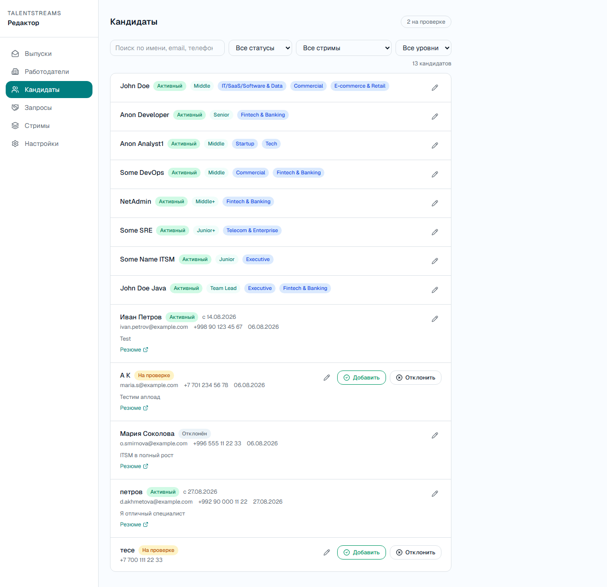

Карандаш открывает форму с именем, ролью, email, телефоном, резюме, сопроводительным письмом, summary, уровнем, стримами, страной и датой активности — включая *Роль* и *Summary*, то есть всё, что реально видит работодатель на карточке. Пара старых полей (`Industry`/`Function`) системой сейчас нигде не используется и в форме не показывается — заполнять их не нужно.

[NOTE]
====
*ℹ️ Что реально происходит по клику «Добавить»*

Если у кандидата указан email — он автоматически получает приветственное письмо (объясняет анонимность, как работает согласие на передачу контактов, что раз в месяц будут приходить итоги). Кандидат без email никуда не добавляется и писем не получает — не критично, просто не на чём рассылать. Подробнее, какие ещё письма получает кандидат и как ими управлять — <<Автоматические письма кандидатам и работодателям>>.
====

== Работодатели — где заполнять и что важно

В отличие от кандидатов, здесь только один способ — форма на сайте. Отдельной таблицы для ручного ввода работодателей нет.

Кнопка «Подписаться на рассылку» в шапке сайта — форма собирает имя, компанию (обязательное поле — по мере ввода сайт подсказывает уже существующие компании, можно выбрать из списка или вписать новую), контакты, способ связи, до двух стримов и страну/страны.

«Страна нахождения» теперь обязательна — если нужной страны нет в списке, выбирайте «Другая». «Дополнительные страны» можно оставить пустым: сайт сам сохранит это как «Любая» (т.е. гео-фильтр подборки для этого работодателя не будет ограничен странами вообще) — щёлкать «Любая» вручную не обязательно, но можно, результат тот же.

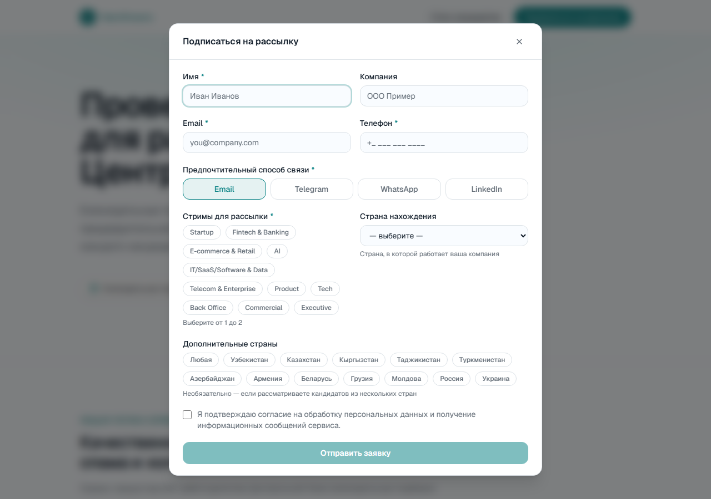

Заявка сразу видна в редакторе со статусом «На проверке». Служебный идентификатор (по нему строится персональная ссылка на подборку и связь с рассылкой) форма генерирует сама при отправке, каждый раз без исключений — прежней подстраховки «на случай, если скрипт не сработал при массовой вставке» здесь больше не нужно.

=== Подтверждение — раздел «Работодатели» на сайте

Здесь та же панель фильтров (поиск, статус, страна, стрим), карандаш для редактирования любых полей кроме статуса, и кнопки «Подтвердить»/«Отклонить» для заявок «На проверке».

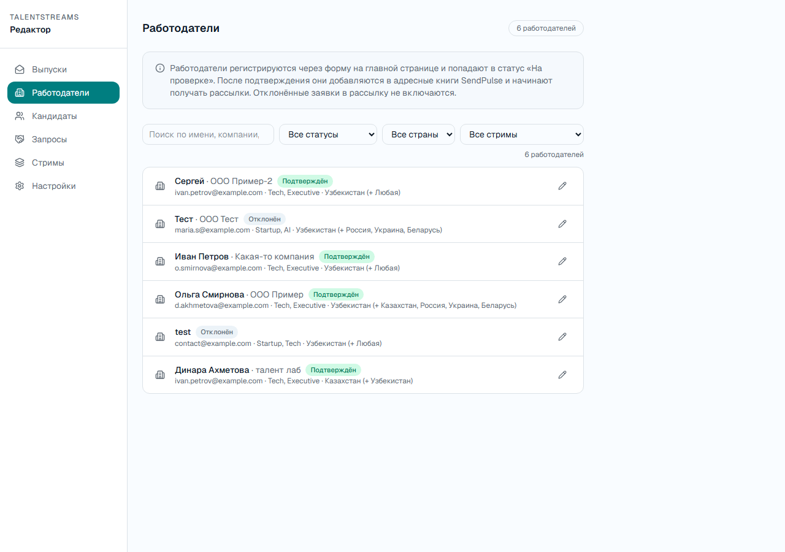

[NOTE]
====
*ℹ️ Что реально происходит по клику «Подтвердить»*

Работодатель добавляется в базу рассылки (SendPulse) и сразу же автоматически получает приветственное письмо. Нажимайте только когда контакты и стримы точно верны — отменить отправку письма потом нельзя, только откорректировать данные на будущее.
====

=== Компании — кто у кого работает

Отдельный раздел «Компании» в редакторе — список всех компаний, из которых зарегистрированы работодатели. Строка раскрывается кликом и показывает всех людей из этой компании с их статусом («На проверке»/«Подтверждён»/«Отклонён»).

Полезно для двух вещей: проверить, что у компании уже есть подтверждённый контакт, прежде чем подтверждать ещё одного человека оттуда же, и найти точное написание названия компании для поля «Исключённые компании» в форме редактирования кандидата (см. предупреждение выше). Компании без указанного названия (были заведены до того, как поле стало обязательным) сгруппированы под «Не определено».

[[selections-vs-releases]]
== Подборки и выпуски — как это устроено

Раньше одна и та же карточка выпуска означала сразу всё: и кому физически уйдёт письмо, и что увидит получатель по ссылке — один фиксированный список кандидатов на весь стрим. Сейчас это две разные вещи:

* *Подборка* — набор кандидатов, подготовленный заранее для стрима (и своей даты). Бывает *общая* (видна любому подписчику стрима, у кого нет личной) и *ограниченная* (видна только выбранным работодателям/компаниям — остальные её не увидят вовсе). Готовится в отдельном разделе «Подборки», до и независимо от конкретного выпуска.
* *Выпуск* («рассылка») — письмо, которое реально уходит в SendPulse. При создании выпуска вы просто *выбираете* уже готовые подборки (хотя бы одну) — состав в самом выпуске не редактируется, только отмечается галочкой.

[WARNING]
====
*⚠️ Почему это вообще разделили*

Раньше, чтобы показать разным компаниям одного стрима разный контент, под каждую нужна была своя узкая SendPulse-книга и своя отдельная кампания. На практике это оказалось тяжело эксплуатировать — по двум причинам:

* *Рассылки по узким книгам не успевали отправиться.* Только что созданный в SendPulse адрес не всегда успевал проиндексироваться к моменту отправки кампании — она падала с ошибкой, и такую рассылку приходилось пересылать вручную по несколько раз подряд.
* *У SendPulse жёсткий лимит — 4 запуска кампании через API в час.* Если персональных книг на один стрим было много (разным компаниям — разный контент), разослать все письма можно было не быстрее 4 в час. Рассылка, которая логически должна была уйти за несколько минут, растягивалась на целый день.

Теперь письмо (кампания в SendPulse) по-прежнему одно на весь стрим — а то, что конкретный работодатель увидит, перейдя по ссылке, решает не отдельная кампания, а персональная подборка: один выпуск, одна отправка, разное содержимое на разных ссылках.
====

== Подборки — готовим контент заранее

=== Раздел «Подборки»

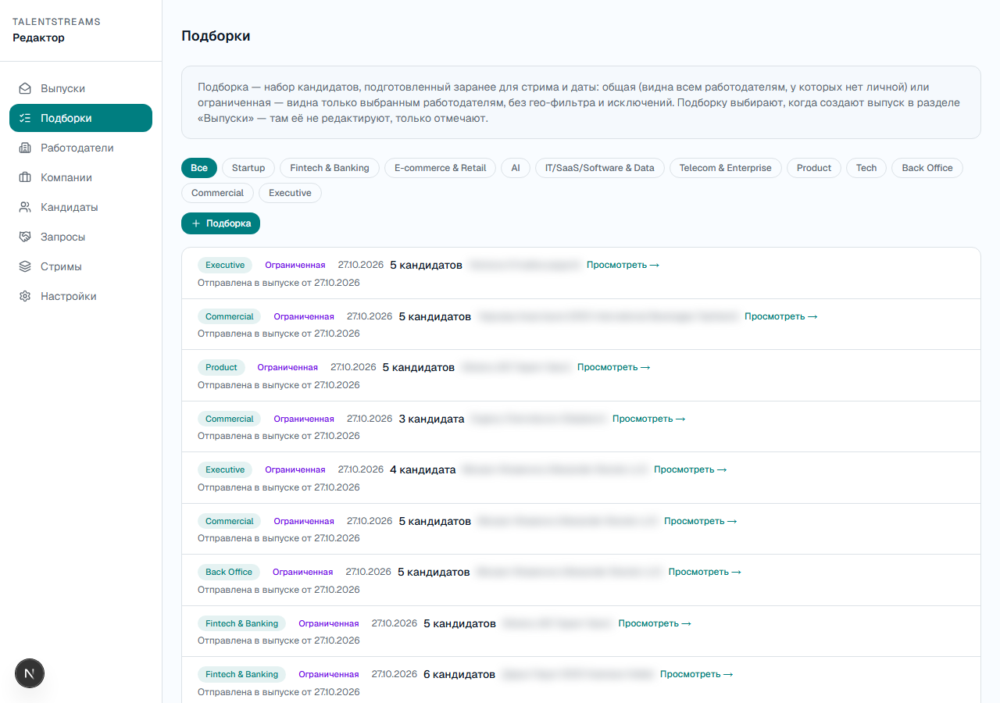

По умолчанию видны подборки *всех* стримов сразу — фильтр сверху нужен, только если хотите сузить список до одного стрима. У каждой строки: стрим, тип (Общая/Ограниченная), дата, число кандидатов, а для ограниченной — ещё и работодатели с компанией в скобках, которым она видна. Подпись под строкой показывает, где сейчас подборка: «В пуле — свободна для любого выпуска», «Используется в неотправленном выпуске от …» или «Отправлена в выпуске от …».

Ссылка «Просмотреть →» у каждой строки открывает саму подборку так, как её увидел бы работодатель — без гео-фильтра и исключений, прямой осмотр содержимого. Доступно только по ссылке редактора (`?secret=`) — работодателю эта страница никогда не показывается и никуда не рассылается.

=== Кнопка «Подборка»

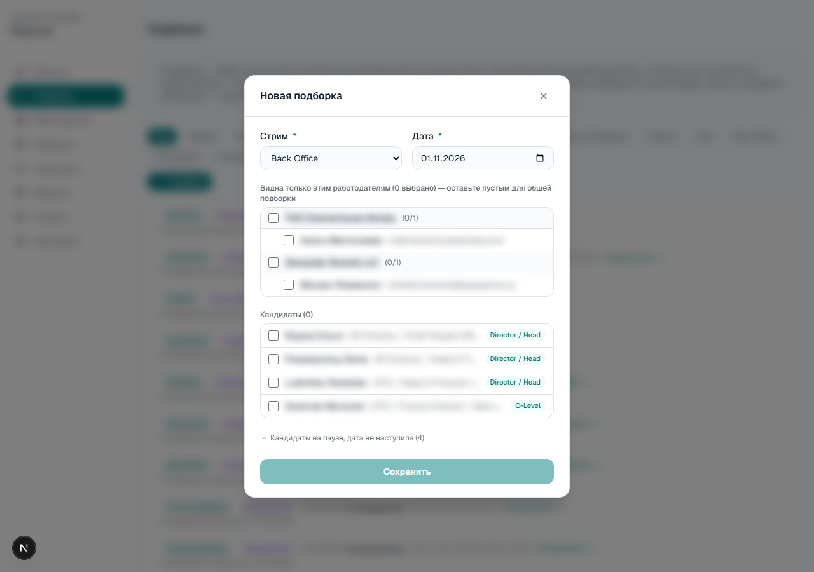

. Выберите *стрим* и *дату*. Дата подборки — независимая величина: её можно поменять позже, и она не обязана совпадать с датой выпуска, в который подборку в итоге заберут.
. «Видна только этим работодателям» — оставьте пустым для *общей* подборки (её увидит любой подписчик стрима, у кого нет своей личной). Отметьте одного или нескольких работодателей — галочка у названия компании отмечает разом всех её людей — и получится *ограниченная* подборка: увидят только они, остальные вообще её не увидят.
. Отметьте кандидатов галочками — список уже отфильтрован по стриму и статусу «Активный» с уже наступившей датой «Активен с»; схлопнутый список «Кандидаты на паузе» работает так же, как раньше у выпуска — можно включить вручную, даже если по правилам ещё рано.
. «Сохранить» — подборка попадает в пул, свободна для любого выпуска этого стрима.

IMPORTANT: ❗ Состав подборки (кандидаты и работодатели) правится *только* здесь, карандашом у нужной строки — независимо от того, свободна она сейчас в пуле или уже используется в неотправленном выпуске. В самом выпуске подборку можно только выбрать или снять галочку, содержимое там не редактируется. Unlink открепляет подборку от неотправленного выпуска обратно в пул (не удаляет), Trash удаляет насовсем — оба недоступны, если подборка в составе уже отправленного выпуска.

TIP: 💡 У одного выпуска может быть не больше одной общей подборки, но ограниченных — сколько угодно. Валидный случай — вообще без общей, если ограниченные в сумме покрывают всех подписчиков стрима; тогда остальные подписчики увидят по ссылке «Подборка для вас пока не готова».

== Как собрать и отправить выпуск

IMPORTANT: ❗ Выпуски хранятся в базе данных — таблицы «Mailing lists» в Google Sheets больше не существует. Единственный способ собрать выпуск — кнопка «Создать рассылку» ниже, и перед этим должна быть готова хотя бы одна подборка нужного стрима (см. выше).

=== Кнопка «Создать рассылку»

В разделе «Выпуски» — кнопка «Создать рассылку». Открывается форма:

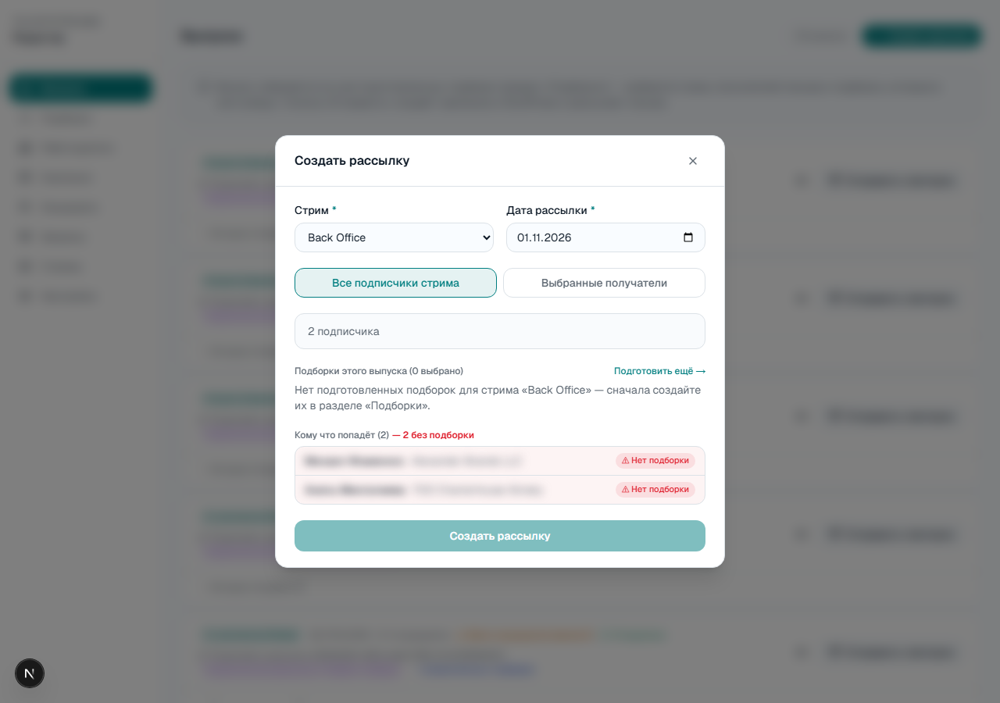

. Выберите *стрим* и *дату*.
. Переключатель «Все подписчики стрима» / «Выбранные получатели» — по умолчанию выбран первый вариант (письмо получат все подтверждённые подписчики стрима). Нужно отправить только конкретным компаниям или работодателям — переключитесь на «Выбранные получатели»: появится список подтверждённых подписчиков этого стрима, сгруппированный по компании, галочка у компании отмечает разом всех её людей. Это по-прежнему отдельная ось от подборок — она решает, *кому физически уйдёт письмо*, а не что в нём будет видно.
. «Подборки этого выпуска» — отметьте галочкой одну или несколько уже подготовленных подборок нужного стрима. Если список пуст — ссылка «Подготовить ещё →» ведёт прямо в раздел «Подборки». Без хотя бы одной подборки выпуск не создать.
. Таблица «Кому что попадёт» — видна всегда, без условий: по каждому получателю письма показывает, увидит он общую подборку, свою ограниченную, или у него нет подходящей подборки вовсе («⚠ Нет подборки», строка подсвечена). Это не отдельное предупреждение, а прямое отражение того, что реально произойдёт при отправке.
. Нажмите «Создать рассылку» — выпуск появится в списке ниже, дальше как обычно: «Отправить».

=== Отправка

. *Откройте раздел «Выпуски» на сайте.* +
Новая карточка появится по вашему `List ID`. Если кандидатов меньше 6 или больше 10 — увидите жёлтое предупреждение прямо на карточке, это не блокирует отправку. Фиолетовый бейдж «Ограниченная рассылка: <компании>» — если письмо физически сужено до конкретных получателей (переключатель выше); синий бейдж «N ограниченных подборок» — если часть содержимого персонализирована под конкретных работодателей. Это два независимых признака, могут быть оба сразу, один или ни одного. +
+
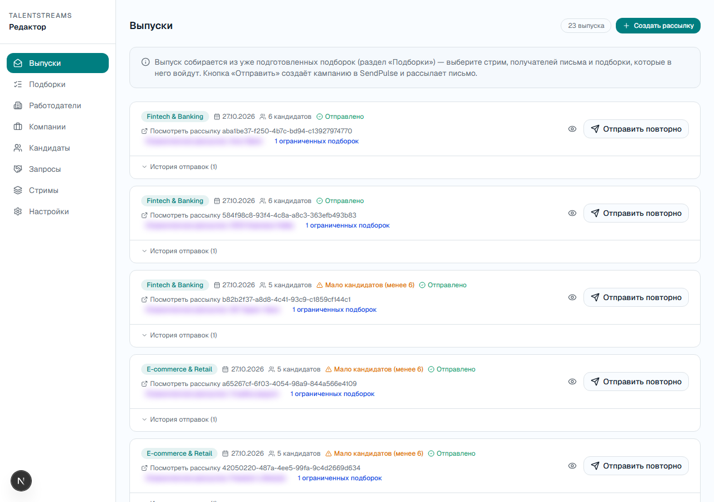

. *Нажмите «Отправить».* +
Если у стрима нет ни одного подтверждённого подписчика, кнопка покажет «Нет подписчиков» и не даст отправить. Если среди получателей письма есть хоть один без применимой подборки — вместо отправки появится предупреждение «N без подборки» с кнопкой «Отправить всё равно»: система не отправит молча мимо того, у кого откроется пустая страница, пока вы явно не подтвердите. Уже отправленный выпуск можно отправить повторно кнопкой «Отправить повторно».
+
Дата на карточке выпуска — это план, а не обязательство: если отправляете не в тот день, что планировали при создании выпуска, дата сама обновится на сегодняшнюю в момент первой отправки. Повторная отправка того же выпуска дату уже не меняет.

Работодатель получает письмо со ссылкой на персональную подборку (без точного числа кандидатов текстом в письме — специально, чтобы не давать обещаний, которые может не выполнить гео-фильтр). Перейдя по ссылке, он видит анонимные карточки: должность, уровень, страна, теги стримов, краткое summary — без имён и контактов. Если у него подключён Telegram-бот — отдельно придёт push с точным числом кандидатов, которое увидит именно он (не общее число по всему выпуску).

[NOTE]
====
*ℹ️ Что происходит, когда работодатель жмёт «Хочу связаться»*

Кандидату (если указан email) сразу автоматически уходит письмо: «вашим резюме заинтересовался работодатель: *название компании*» — **без имени, email и телефона самого работодателя**, это жёсткое правило. Кандидата просят подтвердить согласие на передачу резюме *ответом на письмо*, не кнопкой. Сам запрос появляется в разделе «Запросы» редактора со статусом «Новый запрос» — дальнейшее общение с кандидатом (узнать, ответил ли он, согласен ли) пока полностью на вас, система этого не отслеживает.
====

TIP: Ошиблись в выпуске, который ещё не отправляли? Рядом с «Отправить» — корзина: подтвердите удаление, и выпуск пропадёт (выбранные в нём подборки не удаляются, просто возвращаются в пул). Как только выпуск отправлен хотя бы раз, корзина исчезает — удалить отправленный выпуск через сайт нельзя (кампания уже ушла работодателям, удаление это не отменит).

=== Редактирование и просмотр выпуска

Рядом с «Отправить» на каждой карточке — ещё одна кнопка-иконка: карандаш на неотправленном выпуске, глаз на уже отправленном.

* **Карандаш (неотправленный выпуск)** — та же форма, что при создании: дата, переключатель получателей письма, список подборок с галочками, таблица «Кому что попадёт». Стрим поменять нельзя — для другого стрима нужен новый выпуск. Поправили что нужно — «Сохранить».
* **Глаз (отправленный выпуск)** — то же самое, но без возможности что-либо менять: дата, кому реально ушло письмо, какие подборки были выбраны — с той же таблицей «Кому что попадёт». Удобно, чтобы вспомнить, что именно увидел конкретный работодатель по этому выпуску, не разбирая бейджи по памяти.

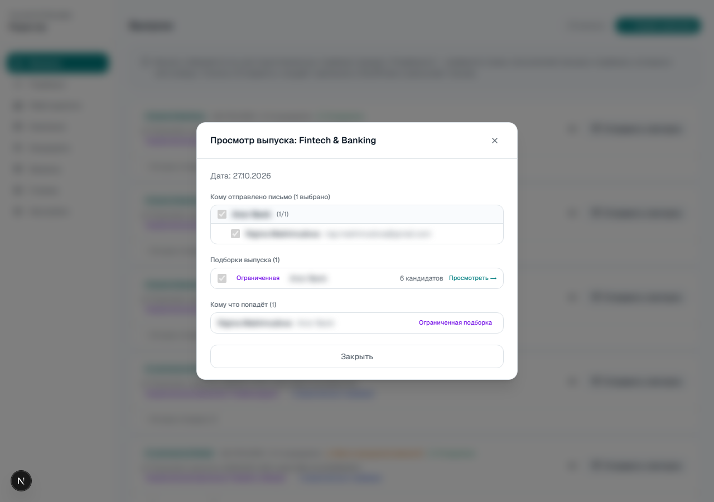

== Автоматические письма кандидатам и работодателям

Помимо самой рассылки-подборки, система сама отправляет ещё несколько писем — часть сразу по событию (клик, одобрение), часть по расписанию. Расписанием управляете вы, в разделе «Настройки» редактора.

=== Кандидатам — три письма

. *«Вашим резюме заинтересовался работодатель»* — сразу, как только работодатель жмёт «Хочу связаться» (см. предупреждение выше). Только название компании, никогда — сам работодатель.
. *Приветственное письмо* — сразу при нажатии «Добавить» в разделе «Кандидаты» (см. предупреждение выше). Объясняет анонимность и как устроено согласие.
. *Ежемесячный дайджест* — «вас увидели N работодателей». Уходит раз в месяц, в первый понедельник, всем подтверждённым кандидатам с email разом. Число — реальный подсчёт (сколько разных работодателей реально видели кандидата в отправленных выпусках); если реальное меньше 8 — показывается случайное число 8–16, чтобы не обескураживать тех, кого пока видели мало.

=== Работодателям — фоллоу-ап после рассылки

Через 3–21 день после отправки каждого выпуска система смотрит, что сделал каждый получатель письма, и решает — один раз, навсегда для этой пары «выпуск + работодатель»:

* *Открыл письмо, но не оставил заявку* → уходит письмо с просьбой дать обратную связь по подборке — вдруг кандидаты не те, или в сервисе чего-то не хватает.
* *Письмо вообще не открыл* → уходит персональное напоминание с именем, названием стрима и ссылкой на тот же выпуск.
* *Уже оставил заявку по этому выпуску* → ничего не отправляется, независимо от того, что показывает статус «открыл/не открыл» — заявка для нас более надёжный признак интереса, чем техническая отметка об открытии письма (она иногда не срабатывает, даже если письмо реально прочитали).

=== Где управлять — раздел «Настройки»

Ниже блока импорта кандидатов (см. <<Способ В. Заполнить Google-таблицу и импортировать>>) — два одинаковых по устройству блока: «Ежемесячный дайджест кандидатам» и «Фоллоу-ап после рассылки работодателям». В каждом:

* *Тумблер* — включает/выключает автоматическую отправку по расписанию. Выключенный тумблер не отменяет уже запланированные письма, он просто не даёт плановому крону запуститься в следующий раз — кнопка «Отправить сейчас» ниже продолжает работать независимо от тумблера.
* *Кнопка «Отправить сейчас»* — запускает отправку прямо сейчас, вне расписания, с подтверждением перед отправкой. Полезно, если нужно отправить раньше срока или перепроверить после сбоя.
* *Таблица истории* — каждая строка: когда, кем запущено (по расписанию/вручную), и числа (сколько писем какого типа ушло, сколько ошибок).

[WARNING]
====
*⚠️ «Отправить сейчас» — это реальная отправка, не тест*

Кнопка сразу шлёт настоящие письма настоящим людям — кандидатам или работодателям, в зависимости от блока. Нажимайте осознанно, не для проверки «а что будет».
====

== Шпаргалка

=== Перед тем как добавить кандидата вручную

* `Стрим` совпадает с названием из списка дословно
* `Summary` написан — это единственное, что увидит работодатель
* Статус после добавления — «На проверке»: кандидат никому не виден, пока не одобрите (§3)

=== Перед тем как подтвердить работодателя

* Email и телефон верны — подтверждение необратимо шлёт письмо
* `Streams` совпадают с названиями из списка

=== Перед тем как создать подборку

* `Стрим` и дата выбраны верно — дата подборки отдельная от даты выпуска, её можно поменять позже
* Для ограниченной подборки отмечены именно те работодатели/компании, кому она должна быть видна — остальные её не увидят вовсе

=== Перед отправкой выпуска

* У стрима есть хотя бы одна подготовленная подборка (общая или ограниченные) — иначе выпуск не создать
* У стрима есть хотя бы один подтверждённый подписчик
* В таблице «Кому что попадёт» нет строк «⚠ Нет подборки» — если есть, отправка потребует явного подтверждения

=== Перед «Отправить сейчас» в Настройках

* Это реальная отправка реальным людям, не тестовый прогон (см. <<Автоматические письма кандидатам и работодателям>>)
* Если просто хотите, чтобы письма продолжали уходить по расписанию — тумблер включён, кнопку жать не нужно вообще

== Если что-то не так

Не открывается редактор, ссылка на подборку не работает, письмо не пришло — не гадайте, что сломалось: сразу к *Алексею Калинину*. Почти всегда причина одна из пунктов в шпаргалке выше.
